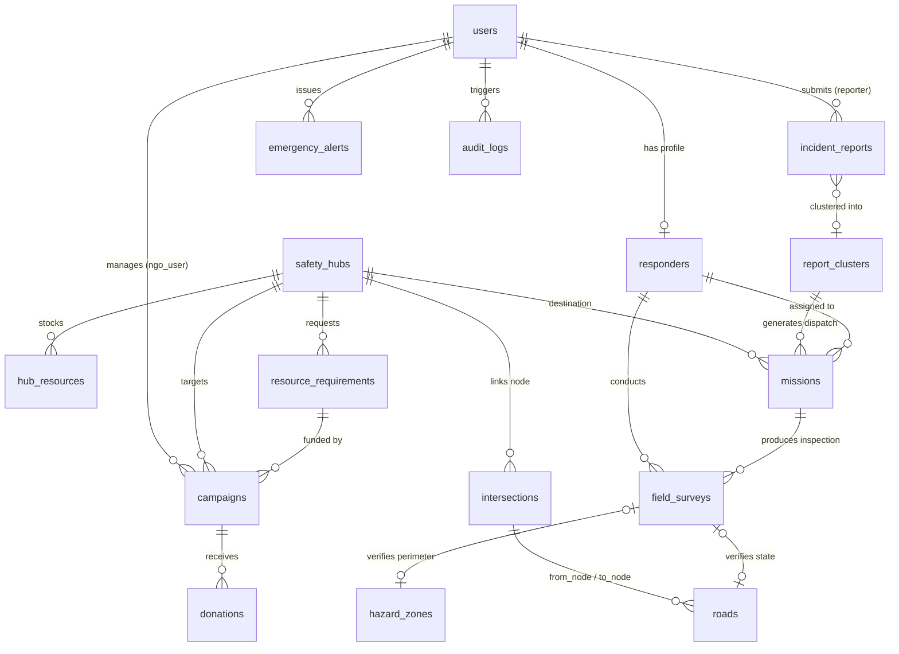

# RESQNET — DATABASE + API KEY STRUCTURE EXTRACTION
**Report Version**: 6.18-B  
**Mode**: Technical Architecture Extraction (Read-Only Reconnaissance)

---

## 1. DATABASE STRUCTURE

### 1.1 Database Engine & Migration Metadata
- **Database Technology**: PostgreSQL with PostGIS Spatial Extension
- **Drivers / Dialects**:
  - Runtime Async Engine: `asyncpg` (`postgresql+asyncpg://`)
  - Migration / CLI Sync Engine: `psycopg2` (`postgresql+psycopg2://`)
  - Spatial Engine: GeoAlchemy2 (`geoalchemy2.Geometry`)
- **Postgres / PostGIS Requirements**:
  - Postgres: `16` (Docker image: `postgis/postgis:16-3.4`)
  - PostGIS: `3.4`
  - Spatial Reference System (SRID): `4326` (WGS84 Coordinate Reference System)
- **Current Alembic Head / Version**: `71867cddef4b` (`71867cddef4b_initial_frozen_v1_schema.py`)

---

### 1.2 Enumerations (14 Authoritative Enums)

| Enum Name | Values |
|---|---|
| `UserRole` | `citizen`, `responder`, `coordinator`, `fundraiser` |
| `ResponderStatus` | `available`, `deployed`, `on_mission`, `offline` |
| `ReportStatus` | `unverified`, `clustered`, `verified`, `rejected` |
| `ReportClusterStatus` | `open`, `mission_assigned`, `verified`, `dismissed` |
| `RoadStatus` | `clear`, `hazardous`, `flooded`, `blocked` |
| `HubStatus` | `open`, `near_capacity`, `full`, `closed` |
| `MissionType` | `verify_incident`, `survey_road`, `deliver_resource`, `rescue` |
| `MissionStatus` | `assigned`, `accepted`, `in_progress`, `completed`, `rejected`, `cancelled` |
| `FieldSurveyVerificationOutcome` | `confirmed_hazard`, `road_blocked`, `no_hazard_found`, `false_report` |
| `HazardSeverity` | `LOW`, `MEDIUM`, `HIGH`, `CRITICAL` |
| `AlertSeverity` | `ADVISORY`, `WARNING`, `EMERGENCY` |
| `CampaignStatus` | `active`, `fulfilled`, `closed` |
| `ResourceType` | `food`, `water`, `medical`, `shelter_kit` |
| `RequirementStatus` | `open`, `in_transit`, `fulfilled`, `cancelled` |

---

### 1.3 Complete Table Hierarchy & Schemas (17 Application Tables)

#### 1. `users` (Core Identity & RBAC)
```text
users
 ├── id (Integer, PK)
 ├── email (String(255), UNIQUE, indexed)
 ├── full_name (String(255))
 ├── hashed_password (String(255))
 ├── role (Enum(UserRole), default='citizen')
 ├── is_active (Boolean, default=True)
 ├── created_at (DateTime(timezone=True))
 └── updated_at (DateTime(timezone=True))
```

#### 2. `intersections` (Routing Graph Nodes)
```text
intersections
 ├── id (Integer, PK)
 ├── name (String(255))
 ├── lat (Float)
 ├── lng (Float)
 ├── geom (Geometry(POINT, SRID=4326), spatial_index)
 ├── is_hub (Boolean, default=False)
 └── hub_id (FK → safety_hubs.id, ON DELETE SET NULL, indexed)
```

#### 3. `roads` (Routing Graph Edges)
```text
roads
 ├── id (Integer, PK)
 ├── name (String(255))
 ├── from_intersection_id (FK → intersections.id, ON DELETE RESTRICT, indexed)
 ├── to_intersection_id (FK → intersections.id, ON DELETE RESTRICT, indexed)
 ├── distance_km (Float, default=1.0)
 ├── hazard_penalty (Float, default=0.0)
 ├── flood_penalty (Float, default=0.0)
 ├── congestion_penalty (Float, default=0.0)
 ├── is_blocked (Boolean, default=False)
 ├── is_bidirectional (Boolean, default=True)
 ├── status (Enum(RoadStatus), default='clear')
 ├── confidence_score (Float, default=1.0, CHECK [0.0, 1.0])
 ├── last_verified_survey_id (FK → field_surveys.id, ON DELETE SET NULL, indexed)
 ├── last_verified_at (DateTime(timezone=True))
 ├── geom (Geometry(LINESTRING, SRID=4326), spatial_index)
 ├── created_at (DateTime(timezone=True))
 └── updated_at (DateTime(timezone=True))
```

#### 4. `hazard_zones` (Spatial Danger Perimeters)
```text
hazard_zones
 ├── id (Integer, PK)
 ├── name (String(255))
 ├── hazard_type (String(100))
 ├── severity (Enum(HazardSeverity), default='LOW')
 ├── is_active (Boolean, default=True)
 ├── last_verified_survey_id (FK → field_surveys.id, ON DELETE SET NULL, indexed)
 ├── geom (Geometry(POLYGON, SRID=4326), spatial_index)
 ├── created_at (DateTime(timezone=True))
 └── updated_at (DateTime(timezone=True))
```

#### 5. `incident_reports` (Tier-1 Crowdsourced Citizen Signals)
```text
incident_reports
 ├── id (Integer, PK)
 ├── reporter_id (FK → users.id, ON DELETE SET NULL, nullable for anon, indexed)
 ├── category (String(100))
 ├── description (Text)
 ├── status (Enum(ReportStatus), default='unverified')
 ├── lat (Float)
 ├── lng (Float)
 ├── geom (Geometry(POINT, SRID=4326), spatial_index)
 ├── photo_url (String(512))
 ├── cluster_id (FK → report_clusters.id, ON DELETE SET NULL, indexed)
 ├── submitted_offline (Boolean, default=False)
 ├── client_timestamp (DateTime(timezone=True))
 ├── verified_at (DateTime(timezone=True))
 ├── verified_by_id (FK → users.id, ON DELETE SET NULL, indexed)
 ├── created_at (DateTime(timezone=True))
 └── updated_at (DateTime(timezone=True))
```

#### 6. `report_clusters` (Spatial-Temporal Aggregated Incidents)
```text
report_clusters
 ├── id (Integer, PK)
 ├── centroid_lat (Float)
 ├── centroid_lng (Float)
 ├── geom (Geometry(POINT, SRID=4326), spatial_index)
 ├── report_count (Integer, default=1)
 ├── priority_score (Float, default=0.0)
 ├── dominant_category (String(100))
 ├── status (Enum(ReportClusterStatus), default='open')
 ├── created_at (DateTime(timezone=True))
 └── updated_at (DateTime(timezone=True))
```

#### 7. `responders` (Field Responder Profiles)
```text
responders
 ├── id (Integer, PK)
 ├── user_id (FK → users.id, ON DELETE CASCADE, UNIQUE, indexed)
 ├── ngo_name (String(255))
 ├── status (Enum(ResponderStatus), default='available')
 ├── last_known_lat (Float)
 ├── last_known_lng (Float)
 ├── geom (Geometry(POINT, SRID=4326), spatial_index)
 ├── last_seen_at (DateTime(timezone=True))
 ├── created_at (DateTime(timezone=True))
 └── updated_at (DateTime(timezone=True))
```

#### 8. `missions` (Field Dispatch Tasks)
```text
missions
 ├── id (Integer, PK)
 ├── mission_type (Enum(MissionType))
 ├── status (Enum(MissionStatus), default='assigned')
 ├── title (String(255))
 ├── description (Text)
 ├── responder_id (FK → responders.id, ON DELETE SET NULL, indexed)
 ├── cluster_id (FK → report_clusters.id, ON DELETE SET NULL, indexed)
 ├── road_id (FK → roads.id, ON DELETE SET NULL, indexed)
 ├── hub_id (FK → safety_hubs.id, ON DELETE SET NULL, indexed)
 ├── target_lat (Float)
 ├── target_lng (Float)
 ├── geom (Geometry(POINT, SRID=4326), spatial_index)
 ├── notes (Text)
 ├── created_at (DateTime(timezone=True))
 ├── accepted_at (DateTime(timezone=True))
 ├── completed_at (DateTime(timezone=True))
 └── updated_at (DateTime(timezone=True))
```

#### 9. `field_surveys` (Tier-2 Ground Truth Physical Inspections)
```text
field_surveys
 ├── id (Integer, PK)
 ├── mission_id (FK → missions.id, ON DELETE SET NULL, indexed)
 ├── responder_id (FK → responders.id, ON DELETE RESTRICT, indexed)
 ├── road_id (FK → roads.id, ON DELETE SET NULL, indexed)
 ├── cluster_id (FK → report_clusters.id, ON DELETE SET NULL, indexed)
 ├── observed_lat (Float)
 ├── observed_lng (Float)
 ├── observed_geom (Geometry(POINT, SRID=4326), spatial_index)
 ├── observed_condition (Text)
 ├── road_status (Enum(RoadStatus))
 ├── hazard_penalty (Float)
 ├── flood_penalty (Float)
 ├── congestion_penalty (Float)
 ├── is_blocked (Boolean)
 ├── hazard_level (Integer, CHECK [1, 5])
 ├── verification_outcome (Enum(FieldSurveyVerificationOutcome))
 ├── media_url (String(512))
 ├── notes (Text)
 ├── submitted_offline (Boolean, default=False)
 ├── client_timestamp (DateTime(timezone=True))
 └── submitted_at (DateTime(timezone=True))
```

#### 10. `safety_hubs` (Relief Centers & Supply Depots)
```text
safety_hubs
 ├── id (Integer, PK)
 ├── name (String(255))
 ├── address (Text)
 ├── lat (Float)
 ├── lng (Float)
 ├── geom (Geometry(POINT, SRID=4326), spatial_index)
 ├── max_capacity (Integer, default=500, CHECK > 0)
 ├── current_occupancy (Integer, default=0, CHECK >= 0)
 ├── status (Enum(HubStatus), default='open')
 ├── food_critical_threshold (Float, default=0.20)
 ├── water_critical_threshold (Float, default=0.20)
 ├── medical_critical_threshold (Float, default=0.20)
 ├── capacity_critical_threshold (Float, default=0.85)
 ├── created_at (DateTime(timezone=True))
 └── updated_at (DateTime(timezone=True))
```

#### 11. `hub_resources` (Normalized Relief Inventory)
```text
hub_resources
 ├── id (Integer, PK)
 ├── hub_id (FK → safety_hubs.id, ON DELETE CASCADE, indexed)
 ├── resource_type (Enum(ResourceType))
 ├── current_quantity (Float, default=0.0, CHECK >= 0)
 ├── unit (String(50), default='units')
 ├── critical_threshold (Float, default=100.0)
 ├── updated_at (DateTime(timezone=True))
 └── [UNIQUE CONSTRAINT: (hub_id, resource_type)]
```

#### 12. `resource_requirements` (Shortage & Demand Requisitions)
```text
resource_requirements
 ├── id (Integer, PK)
 ├── hub_id (FK → safety_hubs.id, ON DELETE CASCADE, indexed)
 ├── resource_type (Enum(ResourceType))
 ├── required_quantity (Float, default=0.0, CHECK >= 0)
 ├── fulfilled_quantity (Float, default=0.0, CHECK >= 0)
 ├── shortfall_quantity (Float, default=0.0, CHECK >= 0)
 ├── unit (String(50), default='units')
 ├── priority (Integer, default=1, CHECK [1, 5])
 ├── status (Enum(RequirementStatus), default='open')
 ├── created_at (DateTime(timezone=True))
 └── updated_at (DateTime(timezone=True))
```

#### 13. `campaigns` (Relief Crowdfunding Campaigns)
```text
campaigns
 ├── id (Integer, PK)
 ├── title (String(255))
 ├── description (Text)
 ├── status (Enum(CampaignStatus), default='active')
 ├── hub_id (FK → safety_hubs.id, ON DELETE SET NULL, indexed)
 ├── requirement_id (FK → resource_requirements.id, ON DELETE SET NULL, indexed)
 ├── ngo_user_id (FK → users.id, ON DELETE SET NULL, indexed)
 ├── resource_type (Enum(ResourceType))
 ├── target_amount (Float, default=0.0, CHECK >= 0)
 ├── raised_amount (Float, default=0.0, CHECK >= 0)
 ├── share_slug (String(64), UNIQUE, indexed)
 ├── created_at (DateTime(timezone=True))
 └── updated_at (DateTime(timezone=True))
```

#### 14. `donations` (Crowdfunding Ledger)
```text
donations
 ├── id (Integer, PK)
 ├── campaign_id (FK → campaigns.id, ON DELETE CASCADE, indexed)
 ├── donor_name (String(255))
 ├── amount (Float, CHECK > 0)
 ├── message (Text)
 ├── transaction_ref (String(128), UNIQUE, indexed)
 └── created_at (DateTime(timezone=True))
```

#### 15. `emergency_alerts` (Broadcast Emergency Notices)
```text
emergency_alerts
 ├── id (Integer, PK)
 ├── title (String(255))
 ├── message (Text)
 ├── severity (Enum(AlertSeverity), default='ADVISORY')
 ├── alert_type (String(100))
 ├── affected_area_geom (Geometry(MULTIPOLYGON, SRID=4326), spatial_index)
 ├── is_active (Boolean, default=True)
 ├── issued_by_id (FK → users.id, ON DELETE SET NULL, indexed)
 ├── created_at (DateTime(timezone=True))
 └── expires_at (DateTime(timezone=True))
```

#### 16. `sync_queue_log` (Offline Operations Audit & Idempotency)
```text
sync_queue_log
 ├── id (Integer, PK)
 ├── client_id (String(128), indexed)
 ├── operation_id (String(64), UNIQUE, indexed)  -- Idempotency key
 ├── operation_type (String(100))
 ├── payload (JSONB)
 ├── client_timestamp (DateTime(timezone=True))
 ├── received_at (DateTime(timezone=True))
 ├── processed_at (DateTime(timezone=True))
 ├── status (String(50), default='accepted')
 └── conflict_notes (Text)
```

#### 17. `audit_logs` (System-Wide Operational Audit Trail)
```text
audit_logs
 ├── id (Integer, PK)
 ├── actor_id (FK → users.id, ON DELETE SET NULL, indexed)
 ├── action (String(100))
 ├── entity_type (String(100))
 ├── entity_id (Integer)
 ├── old_values (JSONB)
 ├── new_values (JSONB)
 ├── ip_address (String(45))
 └── created_at (DateTime(timezone=True))
```

---

### 1.4 Entity-Relationship Flow Diagram



---

## 2. API ARCHITECTURE

### 2.1 Base Configuration & Routing Mounts
- **Primary Versioned Base Prefix**: `/api/v1`
- **Legacy Compatibility Base Prefix**: `/api` (mirrors core endpoints)
- **API Documentation**:
  - Swagger UI: `/api/docs`
  - ReDoc: `/api/redoc`
  - OpenAPI Spec: `/api/openapi.json`
- **Authentication Mechanism**:
  - OAuth2 Password Bearer with JWT (`Authorization: Bearer <token>`)
  - Algorithm: `HS256`
  - Password Hashes: Direct `bcrypt`
- **RBAC Roles**: `citizen`, `responder`, `coordinator`, `fundraiser`

---

### 2.2 Complete API Modules & Endpoints Structure

```text
/api/v1
 ├── /auth
 │    ├── POST   /register                          (Public: citizen, fundraiser)
 │    ├── POST   /login                             (Public)
 │    ├── POST   /token                             (Public: OAuth2 Form)
 │    └── GET    /me                                (Authenticated: all roles)
 ├── /incident-reports
 │    └── POST   /incident-reports                  (Citizen only)
 ├── /clusters
 │    ├── POST   /clusters/process-report/{id}      (Coordinator, Responder, Citizen)
 │    ├── GET    /clusters                          (Authenticated: all roles)
 │    └── GET    /clusters/{id}                     (Authenticated: all roles)
 ├── /missions
 │    ├── POST   /missions                          (Coordinator only)
 │    ├── GET    /missions                          (Coordinator: all; Responder: assigned only)
 │    ├── GET    /missions/responders               (Coordinator only)
 │    ├── GET    /missions/{id}                     (Coordinator, Assigned Responder)
 │    ├── POST   /missions/{id}/accept              (Assigned Responder only)
 │    ├── POST   /missions/{id}/reject              (Assigned Responder only)
 │    ├── POST   /missions/{id}/start               (Assigned Responder only)
 │    ├── POST   /missions/{id}/complete            (Assigned Responder only)
 │    ├── POST   /missions/{id}/cancel              (Coordinator only)
 │    └── POST   /missions/{id}/reassign            (Coordinator only)
 ├── /field-surveys
 │    ├── POST   /field-surveys                     (Assigned Responder only)
 │    ├── POST   /field-surveys/{id}/propagate      (Coordinator, Responder)
 │    ├── GET    /field-surveys/{id}                (Coordinator, Assigned Responder)
 │    └── GET    /missions/{id}/field-surveys       (Coordinator, Assigned Responder)
 ├── /hazards
 │    ├── GET    /hazards                           (Public / Authenticated)
 │    ├── GET    /hazards/{id}                      (Public / Authenticated)
 │    ├── POST   /hazards                           (Coordinator only)
 │    ├── PATCH  /hazards/{id}                      (Coordinator, Responder)
 │    └── DELETE /hazards/{id}                      (Coordinator only)
 ├── /routing
 │    ├── POST   /routing/calculate                 (Public / Authenticated)
 │    └── GET    /routing/graph                     (Public / Authenticated)
 ├── /hubs
 │    ├── GET    /hubs                              (Authenticated: all roles)
 │    ├── GET    /hubs/{id}                         (Authenticated: all roles)
 │    ├── POST   /hubs                              (Coordinator only)
 │    ├── PATCH  /hubs/{id}/occupancy               (Coordinator, Assigned Responder)
 │    ├── PATCH  /hubs/{id}/status                  (Coordinator only)
 │    └── PATCH  /hubs/{id}/capacity                (Coordinator only)
 ├── /resources & /requirements
 │    ├── GET    /hubs/{id}/resources               (Authenticated: all roles)
 │    ├── PUT    /hubs/{id}/resources/{type}        (Coordinator only)
 │    ├── GET    /hubs/{id}/requirements           (Authenticated: all roles)
 │    ├── POST   /hubs/{id}/requirements           (Coordinator only)
 │    ├── PATCH  /requirements/{id}                 (Coordinator only)
 │    └── POST   /requirements/{id}/deliver         (Active Responder with mission)
 ├── /campaigns
 │    ├── POST   /campaigns                         (Fundraiser, Coordinator)
 │    ├── GET    /campaigns                         (Public)
 │    ├── GET    /campaigns/slug/{slug}             (Public)
 │    ├── GET    /campaigns/{id}                    (Public)
 │    ├── GET    /campaigns/{id}/qr                 (Public)
 │    └── PATCH  /campaigns/{id}                    (Campaign Owner, Coordinator)
 ├── /donations
 │    ├── POST   /donations                         (Public / Authenticated optional)
 │    └── GET    /campaigns/{id}/donations          (Public)
 ├── /alerts
 │    ├── POST   /alerts                            (Coordinator only)
 │    ├── GET    /alerts/active                     (Authenticated: all roles, spatial filter)
 │    ├── GET    /alerts/{id}                       (Authenticated: all roles)
 │    ├── GET    /alerts                            (Coordinator only)
 │    ├── PATCH  /alerts/{id}                       (Coordinator only)
 │    └── DELETE /alerts/{id}                       (Coordinator only)
 ├── /roads
 │    ├── GET    /roads/intersections               (Public / Authenticated)
 │    ├── GET    /roads                             (Public / Authenticated)
 │    ├── GET    /roads/{id}                        (Public / Authenticated)
 │    └── PATCH  /roads/{id}/status                 (Responder, Coordinator)
 ├── /sync
 │    ├── POST   /sync/replay                       (Authenticated: all roles, atomic batch <= 50)
 │    └── GET    /sync/status                       (Public connectivity check)
 └── /simulation  (Mounted at /api/simulation)
      ├── POST   /events/flood                      (Coordinator only)
      ├── POST   /events/road/block                 (Coordinator only)
      ├── POST   /events/road/hazard                (Coordinator only)
      ├── POST   /events/reports/generate           (Coordinator only)
      ├── POST   /events/hub/occupancy              (Coordinator only)
      ├── POST   /events/hub/resources              (Coordinator only)
      ├── POST   /events/dispatch                   (Coordinator only)
      ├── POST   /events/verify                     (Coordinator only)
      ├── POST   /events/reset                      (Coordinator only)
      └── GET    /state                             (Coordinator only)
```

---

### 2.3 RBAC Access Matrix by Module

| Module | Citizen | Responder | Coordinator | Fundraiser | Public / Unauth |
|---|:---:|:---:|:---:|:---:|:---:|
| **Auth** | Self-Service | Admin-Only | Admin-Only | Self-Service | Login / Token |
| **Incident Reports** | Submit (Signal) | ❌ | ❌ | ❌ | ❌ |
| **Clusters** | Process / Read | Process / Read | Full Access | Read | ❌ |
| **Missions** | ❌ | View Assigned / Accept / Reject / Start / Complete | Create / Dispatch / Cancel / Reassign | ❌ | ❌ |
| **Field Surveys** | ❌ | Submit / View Assigned / Propagate | Propagate / View All | ❌ | ❌ |
| **Hazards** | Read | Update / Read | Full CRUD | Read | Read |
| **Routing** | Read / Calculate | Read / Calculate | Read / Calculate | Read / Calculate | Read / Calculate |
| **Safety Hubs** | Read | Read / Update Occupancy | Full CRUD & Overrides | Read | ❌ |
| **Resources & Requirements** | Read | Deliver Resources | Manage Inventory & Shortages | Read | ❌ |
| **Campaigns** | Read | Read | Manage | Create / Manage Own | Read / Donate Slug / QR |
| **Donations** | Read / Donate | Read / Donate | Read / Donate | Read / Donate | Read / Donate |
| **Emergency Alerts** | Read Active | Read Active | Full CRUD Broadcasts | Read Active | ❌ |
| **Roads** | Read | Verify / Update Status | Verify / Update Status | Read | Read |
| **Offline Sync** | Replay Reports | Replay Surveys | Full Replay Audit | ❌ | Status Ping |
| **Simulation** | ❌ | ❌ | Full Access | ❌ | ❌ |

---

### 2.4 Architecture Execution Flow

```text
       [Citizen / Responder / Coordinator Browser]
                           │
             (Online / Offline Transition)
                           │
          ┌────────────────┴────────────────┐
          ▼                                 ▼
   [IndexedDB / Dexie.js]           [Axios API Client]
   (Offline Outbox & Cache)         (Bearer JWT Token Auth)
          │                                 │
          └────────────────┬────────────────┘
                           │ HTTP /api/v1
                           ▼
                 [FastAPI App (main.py)]
         (CORS Middleware, Global Exception Handlers)
                           │
                 [FastAPI Domain Routers]
             (OAuth2 RBAC Dependencies)
                           │
               [Service & Domain Engines]
       ├── Clustering Engine (Spatial + Temporal Radius)
       ├── Routing Engine (Dijkstra + NetworkX Graph Cache)
       ├── Ground Truth Propagation (Concurrency Locks)
       └── Offline Replay Engine (Savepoint Transactions)
                           │
            [SQLAlchemy 2.0 Async Session]
            (AsyncPG Connection Pool / ORM)
                           │
              [PostgreSQL 16 + PostGIS 3.4]
       (Spatial GiST Indexes, ST_Intersects, ST_Covers)
```

---

## 3. API KEYS / ENVIRONMENT VARIABLES

### 3.1 Environment Variable Catalog

| Variable Name | Purpose | Frontend/Backend | Required? | Secret? |
|---|---|---|:---:|:---:|
| `DATABASE_URL` | Async PostgreSQL + PostGIS connection string (`postgresql+asyncpg://...`) | Backend | **Yes** | **Yes** |
| `SYNC_DATABASE_URL` | Sync PostgreSQL connection string for Alembic migrations (`postgresql+psycopg2://...`) | Backend | **Yes** | **Yes** |
| `SECRET_KEY` | Secret key used for signing JWT access tokens | Backend | **Yes** | **Yes** |
| `JWT_SECRET_KEY` | Secondary alias for JWT signing secret key | Backend | **Yes** | **Yes** |
| `JWT_ALGORITHM` | JWT signing cryptographic algorithm (default: `HS256`) | Backend | No | No |
| `ALGORITHM` | Algorithm alias for security module | Backend | No | No |
| `ACCESS_TOKEN_EXPIRE_MINUTES` | Expiration window for access tokens (default: `10080` min = 7 days) | Backend | No | No |
| `ENVIRONMENT` | Deployment environment identifier (`development` / `production`) | Backend | No | No |
| `FRONTEND_URL` | Allowed origin for CORS and QR code link generation | Backend | No | No |
| `CORS_ORIGINS` | JSON array of whitelisted CORS origins | Backend | No | No |
| `CLUSTERING_RADIUS_METERS` | Proximity search radius for incident aggregation (default: `500.0`) | Backend | No | No |
| `CLUSTERING_TEMPORAL_WINDOW_MINUTES` | Time window for temporal incident correlation (default: `120`) | Backend | No | No |
| `POSTGRES_DB` | PostgreSQL database name in Docker Compose (`resqnet`) | Docker / DB | **Yes** | No |
| `POSTGRES_USER` | PostgreSQL user in Docker Compose | Docker / DB | **Yes** | **Yes** |
| `POSTGRES_PASSWORD` | PostgreSQL password in Docker Compose | Docker / DB | **Yes** | **Yes** |

---

### 3.2 External API Providers & Service Integration Analysis

- **Map Tiles / Cartography**:
  - **Service**: OpenStreetMap Tile Server (`https://tile.openstreetmap.org/{z}/{x}/{y}.png`)
  - **Library**: `maplibre-gl` (v6.7.0)
  - **API Key Required**: **No**. Standard public raster tiles are consumed directly without proprietary tokens (e.g. no Mapbox or Google Maps tokens needed).
- **Routing & Navigation Engine**:
  - **Service**: Self-hosted, in-process Dijkstra algorithm with `networkx` computed over PostgreSQL/PostGIS road segments and active hazard polygons.
  - **API Key Required**: **No**. Zero third-party routing APIs (e.g. OSRM, GraphHopper, Google Directions) are used.
- **QR Code Generation**:
  - **Service**: In-memory Python `qrcode` (backend) and `qrcode.react` (frontend).
  - **API Key Required**: **No**.
- **Payment / Crowdfunding Gateway**:
  - **Service**: Built-in mock sandbox donation ledger with unique transaction references (`transaction_ref`).
  - **API Key Required**: **No external payment gateway keys** (e.g. Stripe, Razorpay) are configured or required.
- **Frontend Key Exposure**:
  - **Exposed Keys**: **None**. The frontend Vite configuration proxies `/api` directly to `http://localhost:8000` without bundling secrets.
- **Missing Required Configuration**:
  - **None**. The architecture is 100% self-contained and operates entirely on PostgreSQL/PostGIS and FastAPI services.

---

## 4. FINAL SUMMARY

### DATABASE:
- **DB**: PostgreSQL 16 with PostGIS 3.4 (`asyncpg` runtime, `psycopg2` migrations)
- **Tables (17 total)**: `users`, `intersections`, `roads`, `hazard_zones`, `incident_reports`, `report_clusters`, `responders`, `missions`, `field_surveys`, `safety_hubs`, `hub_resources`, `resource_requirements`, `campaigns`, `donations`, `emergency_alerts`, `sync_queue_log`, `audit_logs`
- **Main Relationships**: 
  - Graph: `intersections` (nodes) ↔ `roads` (edges) ↔ `safety_hubs`
  - Operational Chain: `incident_reports` (Tier-1 unverified signals) → `report_clusters` → `missions` → `field_surveys` (Tier-2 verified ground truth) → `roads` / `hazard_zones`
  - Relief: `safety_hubs` ↔ `hub_resources` ↔ `resource_requirements` ↔ `campaigns` ↔ `donations`
- **PostGIS**: Geometry with SRID 4326 on `POINT`, `LINESTRING`, `POLYGON`, and `MULTIPOLYGON` with GiST spatial indexes.
- **Alembic Head**: `71867cddef4b`

### API:
- **Base URL**: `/api/v1` (with `/api` compatibility layer)
- **Main Modules (14 domain routers)**: `auth`, `incident-reports`, `clusters`, `missions`, `field_surveys`, `hazards`, `routing`, `hubs`, `resources`, `campaigns`, `donations`, `alerts`, `roads`, `sync` (+ `simulation`)
- **Auth**: JWT Bearer Tokens (`HS256`) + `bcrypt`
- **Roles**: `citizen`, `responder`, `coordinator`, `fundraiser`

### API KEYS:
- **External Services**: OpenStreetMap (raster map tiles via MapLibre GL JS — no API key needed).
- **Required Environment Variables**: `DATABASE_URL`, `SYNC_DATABASE_URL`, `SECRET_KEY` (or `JWT_SECRET_KEY`), `POSTGRES_DB`, `POSTGRES_USER`, `POSTGRES_PASSWORD`.
- **Frontend-Exposed Variables**: None (no `VITE_` secrets or external tokens exposed).
- **Missing Configuration**: None (100% self-contained offline-first architecture).
